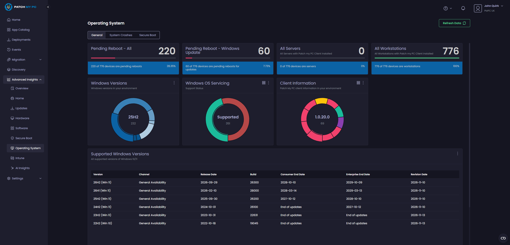

# "Operating System" page

The **Operating System** page in Advanced Insights gives you an overview of the Windows operating systems across your environment, including Windows versions, servicing status and devices that require a restart.

To open it, go to **Advanced Insights > Operating System > General**.

<figure><figcaption></figcaption></figure>

**At a glance**

The statistics at the top of the page show:

* **Pending Reboot - All**: devices currently reporting that a restart is required.
* **Pending Reboot - Windows Update**: devices specifically requiring a restart to complete a Windows update.
* **All Servers**: Windows Server devices reporting through the Patch My PC Client.
* **All Workstations**: Windows workstation devices reporting through the Patch My PC Client.

**Windows Versions**

**Windows Versions** shows the distribution of Windows releases across your devices, making it easy to see which releases are most widely deployed.

**Windows OS Servicing**

**Windows OS Servicing** shows the support status of Windows across your environment.

Use the chart menu to change how the information is grouped, allowing you to explore operating system properties such as servicing channel, release version, edition and build version.&#x20;

**Client Information**

**Client Information** shows the versions of the **Patch My PC Client** reporting from your devices. This helps you identify devices that may still be running an older client.

Use the chart menu to change the view to **Client Check In Time** to see how recently devices have checked in. This view also provides functionality to delete unwanted client machines. Click any of the chart segments, or select View Chart Data to view all Clients and use the checkboxes and Actions button to delete unwanted machines.

<figure><figcaption></figcaption></figure>

**Supported Windows Versions**

The **Supported Windows Versions** table provides a reference for Windows releases and their support lifecycle, including:

* Version
* Channel
* Release Date
* Build
* Consumer End Date
* Enterprise End Date
* Revision Date

This is a reference table only. **Rows in Supported Windows Versions do not provide device-level drill-through.**
