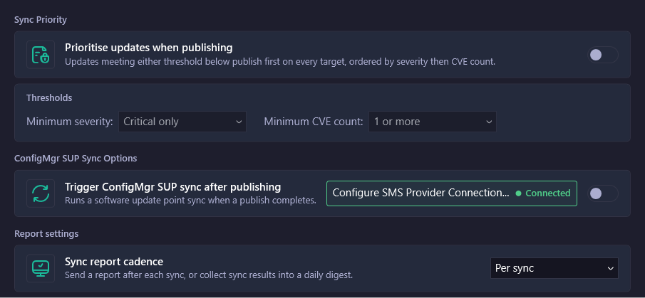

# Configuration

Use the **Configuration** page in Patch My PC Publisher (Publisher) to set options that apply to every sync schedule. This page replaces the **ConfigMgr SUP Sync Options** page.

To open the page, go to **Sync** > **Configuration**.

<figure><figcaption></figcaption></figure>

### Sync Priority

Use **Sync Priority** to publish the most important updates first. When it's on, updates that meet either threshold publish first on every target, ordered by severity and then by CVE count.

| Option                                 | Default           | Values                                                                                              |
| -------------------------------------- | ----------------- | --------------------------------------------------------------------------------------------------- |
| **Prioritise updates when publishing** | Off               | On or off.                                                                                          |
| **Minimum severity:**                  | **Critical only** | **Disabled**, **Critical only**, **Important and above**, **Moderate and above**, **Low and above** |
| **Minimum CVE count:**                 | **1 or more**     | **Disabled**, **1 or more**, **3 or more**, **5 or more**, **10 or more**                           |

To turn on sync priority:

1. Go to **Sync** > **Configuration**.
2. Turn on **Prioritise updates when publishing**.
3. In **Minimum severity:**, select a severity.
4. In **Minimum CVE count:**, select a count.
5. Save your settings.

Sync priority changes the order of publishing. It doesn't add products to a sync. To create a schedule that publishes only these updates, turn on **Only priority updates** for the schedule. See Schedule.

### ConfigMgr SUP Sync Options

Turn on **Trigger ConfigMgr SUP sync after publishing** to run a software update point synchronization in Microsoft Configuration Manager (Configuration Manager) when publishing finishes. This makes new updates available in Configuration Manager without waiting for the next scheduled software update point sync.

Before you turn on this option, configure the SMS Provider connection:

1. Go to **Sync** > **Configuration**.
2. Select **Configure SMS Provider Connection...**.
3. Configure the connection. See Configure SMS Provider Connection.
4. Confirm the connection shows **Connected**.
5. Turn on **Trigger ConfigMgr SUP sync after publishing**.
6. Save your settings.

### Report settings

Use **Sync report cadence** to choose when Publisher sends sync report emails.

| Option           | Result                                                                                                                                         |
| ---------------- | ---------------------------------------------------------------------------------------------------------------------------------------------- |
| **Per sync**     | Sends a report after each sync.                                                                                                                |
| **Daily digest** | Collects the results of each day's syncs and sends one report after the last sync of the day. If the email fails, Publisher tries again later. |

Sync reports use the email settings on the **Alerts** tab. Configure email there before you change the cadence.

### Related pages

* Schedule
* History
