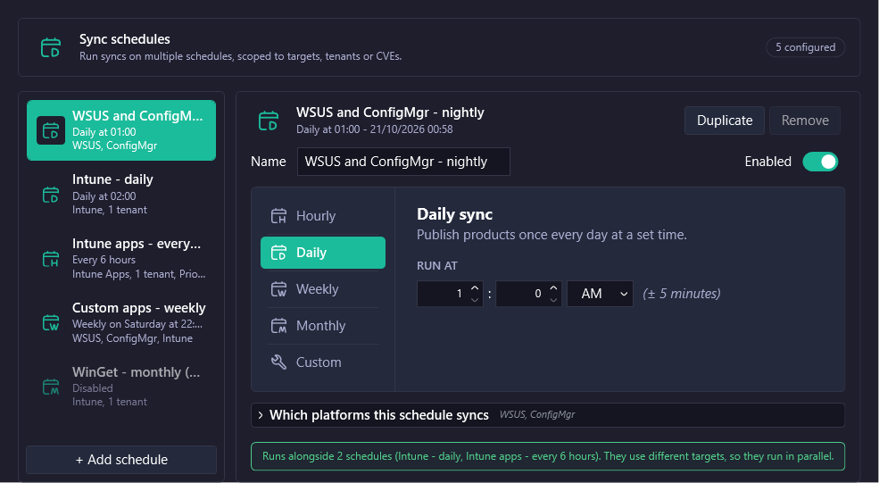
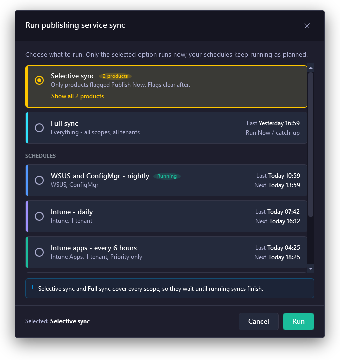

# Multi-Schedule

Use the **Schedule** page in Patch My PC Publisher (Publisher) to run syncs on more than one schedule. Each schedule has its own name, recurrence, targets, and overlap behavior. For example, you can sync Intune Updates every 6 hours and publish to Microsoft Configuration Manager (Configuration Manager) once a week.

To open the page, go to **Sync** > **Schedule**.

<figure><figcaption></figcaption></figure>


If the multiple schedule feature is not enabled for your Publisher, the page shows the single schedule editor instead. See Single schedule editor.


### The schedule list

The list on the left shows every schedule. Each row shows the schedule name, recurrence, next run, and targets. A warning such as **1 conflict** appears on a schedule that overlaps with another schedule that publishes to the same target. The badge at the top shows how many schedules are configured.

Select a schedule in the list to edit it on the right.

### Add a schedule

1. Go to **Sync** > **Schedule**.
2. Select **+ Add schedule**.
3. In **Name**, enter a name for the schedule.
4. Select a schedule type. See Schedule types.
5. Expand **Which platforms this schedule syncs** and select the targets. See Choose what a schedule syncs.
6. Review any overlap message. See Overlapping schedules.
7. Save your settings.

### Duplicate, disable, or remove a schedule

| Action    | How                                             | Result                                                                                                            |
| --------- | ----------------------------------------------- | ----------------------------------------------------------------------------------------------------------------- |
| Duplicate | Select the schedule, then select **Duplicate**. | Creates a copy that you can rename and change.                                                                    |
| Disable   | Turn off **Enabled**.                           | Keeps the schedule but stops it from running automatically. You can still run it manually. See Run a manual sync. |
| Remove    | Select the schedule, then select **Remove**.    | Deletes the schedule.                                                                                             |

### Schedule types

Select a type from the tabs at the top of the editor.

| Type        | Default       | Runs                                                                                   |
| ----------- | ------------- | -------------------------------------------------------------------------------------- |
| **Hourly**  | Every 4 hours | Every set number of hours.                                                             |
| **Daily**   | 7:00 PM       | Once a day at the set time.                                                            |
| **Weekly**  | Monday        | Once a week on the set day and time.                                                   |
| **Monthly** | Day 1         | Once a month on the set day, from 1 to 31.                                             |
| **Custom**  | Second Monday | On a ranked weekday of the month, such as the second Tuesday, with an optional offset. |

#### Hourly

1. Select **Hourly**.
2. In **REPEAT EVERY**, enter the number of hours between runs.

#### Daily

1. Select **Daily**.
2. Enter the hour and minute.
3. Select **AM** or **PM**.

#### Weekly

1. Select **Weekly**.
2. Select the day of the week.
3. Enter the time.

#### Monthly

1. Select **Monthly**.
2. In **ON DAY OF MONTH**, enter a day from 1 to 31.
3. Enter the time.

If the day does not exist in a shorter month, check the next run time before you save.

#### Custom

Use **Custom** to run relative to a weekday in the month. For example, to sync the day after Patch Tuesday, select **Second**, **Tuesday**, and an offset of one day.

1. Select **Custom**.
2. Select **First**, **Second**, **Third**, **Fourth**, or **Last**.
3. Select the weekday.
4. Enter an offset from zero to six days.
5. Enter the time.

### Choose what a schedule syncs

Expand **Which platforms this schedule syncs** to set the scope of the selected schedule. A schedule can include more than one target.

| Option                    | What it includes                                                                               |
| ------------------------- | ---------------------------------------------------------------------------------------------- |
| **WSUS**                  | Publishing to WSUS.                                                                            |
| **ConfigMgr**             | Publishing applications to Configuration Manager.                                              |
| **Intune Apps**           | Publishing applications to Intune.                                                             |
| **Intune Updates**        | Publishing updates to Intune.                                                                  |
| **Only priority updates** | Only updates that meet the priority thresholds on the Configuration page.                      |
| **Intune tenants**        | Only the selected Intune tenants. If you select none, the schedule covers all enabled tenants. |

Targets only appear when they are enabled in Publisher.

### Overlapping schedules

Two schedules overlap when they are due at the same time and publish to the same target, such as WSUS, Configuration Manager, or an Intune tenant. Overlapping runs don't run at the same time.

When the selected schedule overlaps with another, the editor shows a message such as "This schedule overlaps with 1 other schedule". The message lists each overlapping schedule and the target they share.

<figure><figcaption></figcaption></figure>

Under **When a run overlaps**, select what this schedule does when it is due while an overlapping run is still in progress:

| Option             | Result                                                                  |
| ------------------ | ----------------------------------------------------------------------- |
| **Wait, then run** | The run waits until the earlier run finishes, then starts.              |
| **Skip this run**  | The run is skipped. The schedule runs again at its next scheduled time. |

To change the other schedule, select **Go to schedule**. To see when the runs overlap, select **View timeline**. See Timeline.

Overlap messages are a warning only. You can save a schedule that overlaps with another one.

#### Schedules that run in parallel

Schedules that publish to different targets can run at the same time. When this applies, a message such as "Runs alongside 2 schedules" lists them. Publisher runs up to three scheduled syncs at the same time.

### Single schedule editor

If the multiple schedule feature is not enabled, the **Schedule** page shows one schedule. It has the same schedule types. **Next sync if saved:** shows when the next sync runs if you save your changes.

The **ConfigMgr SUP Sync Options** also appear on this page. See Configuration.

### Sync status

**Sync Status** appears at the bottom of the **Sync** tab and shows what the Publishing Service is doing.

| Status        | Description                                                           |
| ------------- | --------------------------------------------------------------------- |
| **Idle**      | No sync is running.                                                   |
| **Syncing**   | A sync is in progress.                                                |
| **Completed** | The last sync finished.                                               |
| **Error**     | The last sync finished with an error. Check the sync log for details. |

When syncs are running or queued, **Active and queued syncs** lists them.

### Run a manual sync

1. Save any pending changes.
2. Select **Run Publishing Service Sync**.
3. Select what to run. See Manual sync options.
4. Select **Run**.

Only the option you select runs now. Your schedules keep running as planned.

<figure><figcaption></figcaption></figure>

#### Manual sync options

| Option                         | When it appears                                        | What it runs                                                                                                                                               |
| ------------------------------ | ------------------------------------------------------ | ---------------------------------------------------------------------------------------------------------------------------------------------------------- |
| **Selective sync**             | When one or more products are flagged for Publish Now. | Only the flagged products. The row lists the products and their targets. Select **Show all** to see the full list. The flags clear when the sync finishes. |
| **Full sync**                  | Always.                                                | Everything, for all targets and all tenants.                                                                                                               |
| A schedule under **SCHEDULES** | One row for each schedule.                             | Only that schedule's targets. Each row shows the last and next run. Disabled schedules show a disabled label but you can still run them.                   |

For more information about flagging products, see Publish Now.


If products are flagged for Publish Now and you select an option other than **Selective sync**, Publisher asks whether to clear the flags. Select **Yes** to clear the flags and run the sync, or **No** to cancel.


#### How manual syncs affect schedules

* Running a schedule manually doesn't change its next scheduled run.
* **Full sync** and **Selective sync** wait for running scheduled syncs to finish before they start.
* If you run a schedule that shares a target with a sync that is already running, the window tells you. The run waits and starts when the running sync finishes. See Overlapping schedules.

### Related pages

* Timeline
* Configuration
* History
