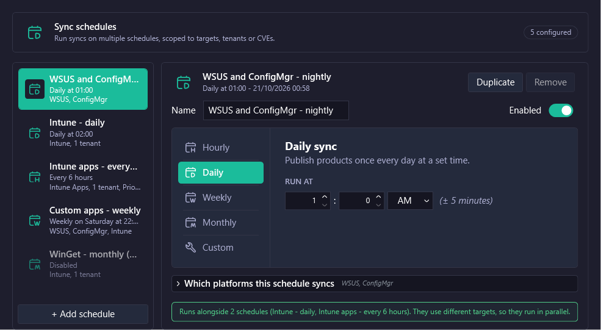
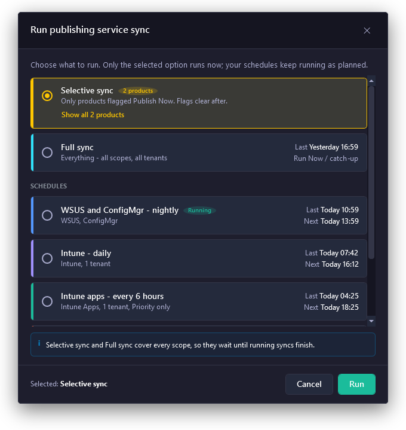

# Configure Multiple Schedules in Patch My PC Publisher

_Applies to: Patch My PC Publisher V3.x_


**PRIVATE PREVIEW**

This feature is currently only available through an invitation-only Private Preview, as both it and the documentation are under development, incomplete, and subject to change.

Please do not share links to these docs with others outside of the Private Preview.

Once this feature is released, it will be announced, and this banner will be removed.


Multiple Sync Schedules can be configured in Patch My PC (PMPC) Publisher. Each schedule requires a unique name and can be configured with settings for recurrence, targets, and overlapping behavior, if required.

For example, you can sync Microsoft Intune Updates every 6 hours and publish to Microsoft Configuration Manager (ConfigMgr) once a week.

## To view the current Sync Schedules

Navigate to **Sync** | **Schedule** to view the list of current sync schedules.

<figure><figcaption></figcaption></figure>


**Note**

If the Multiple Schedule feature is not enabled for your Publisher license, only a [single schedule](schedule.md) will be visible.


## To add a Sync Schedule



### **Click + Add schedule**

<figure><figcaption></figcaption></figure>

The current **Default schedule** is duplicated.



### Enter a unique name

In the **Name** field, enter a unique name for the schedule.

<figure><figcaption></figcaption></figure>



### Select the schedule type

<table><thead><tr><th width="112" valign="top">Type</th><th width="155.3333740234375" valign="top">Default</th><th valign="top">Runs</th></tr></thead><tbody><tr><td valign="top">Hourly</td><td valign="top">Every 4 hours</td><td valign="top">Every set number of hours.</td></tr><tr><td valign="top">Daily</td><td valign="top">7:00 PM</td><td valign="top">Once a day at the set time.</td></tr><tr><td valign="top">Weekly</td><td valign="top">Monday</td><td valign="top">Once a week on the set day and time.</td></tr><tr><td valign="top">Monthly</td><td valign="top">Day 1</td><td valign="top">Once a month on the set day, from 1 to 31.</td></tr><tr><td valign="top">Custom</td><td valign="top">Second Monday</td><td valign="top">On a ranked weekday of the month, such as the second Tuesday, with an optional offset.</td></tr></tbody></table>



### Configure Sync options

Configure the relevant sync settings (which vary depending by sync type), such as days and times.


**Note**

If you chose **Monthly**, if the day does not exist in a shorter month, check the next run time before you save.

Use **Custom** to run relative to a weekday in the month. For example, to sync the day after Patch Tuesday, select **Second**, **Tuesday**, and an offset of one day.

1. Select **Custom**.
2. Select **First**, **Second**, **Third**, **Fourth**, or **Last**.
3. Select the weekday.
4. Enter an offset from zero to six days.
5. Enter the time.




### Optionally configure to run a missed scheduled sync

Decide whether you want to enable the **Run a missed scheduled sync on startup** option (disabled by default). Enabling this option forces Publisher to catch up as soon as possible if the service was offline at the scheduled time. This setting is not affected by manual.

<figure><figcaption></figcaption></figure>



### Select which platforms this schedule syncs

Under the **Which platforms this schedule syncs** section, select the relevant targets that this schedule will sync.


**Note**

Only those targets enabled in Publisher will appear.


<figure><figcaption></figcaption></figure>

<table><thead><tr><th width="176.888916015625" valign="top">Target</th><th valign="top">Includes...</th></tr></thead><tbody><tr><td valign="top">WSUS</td><td valign="top">Publishing to WSUS.</td></tr><tr><td valign="top">ConfigMgr</td><td valign="top">Publishing applications to Configuration Manager.</td></tr><tr><td valign="top">Intune Apps</td><td valign="top">Publishing applications to Intune.</td></tr><tr><td valign="top">Intune Updates</td><td valign="top">Publishing updates to Intune.</td></tr><tr><td valign="top">Only priority updates</td><td valign="top">Only updates that meet the priority thresholds on the Configuration page.</td></tr><tr><td valign="top">Intune tenants</td><td valign="top">Only the selected Intune tenants. If you select none, the schedule covers all enabled tenants.</td></tr></tbody></table>



### Resolve any conflicts

Two schedules overlap when they are due to run at the same time and publish to the same target, such as WSUS, ConfigMgr, or an Intune tenant. Overlapping runs don't run at the same time.

When the selected schedule overlaps with another, the **This schedule overlaps with 1 other schedule** message is shown, explaining the overlapping schedule and the target they share.

<figure><figcaption></figcaption></figure>

???



### Click **Apply**

To save the new Sync Schedule, click **Apply**.



**\*\*\***

<figure><figcaption></figcaption></figure>

### Duplicate, disable, or remove a schedule

| Action    | How                                             | Result                                                                                                            |
| --------- | ----------------------------------------------- | ----------------------------------------------------------------------------------------------------------------- |
| Duplicate | Select the schedule, then select **Duplicate**. | Creates a copy that you can rename and change.                                                                    |
| Disable   | Turn off **Enabled**.                           | Keeps the schedule but stops it from running automatically. You can still run it manually. See Run a manual sync. |
| Remove    | Select the schedule, then select **Remove**.    | Deletes the schedule.                                                                                             |

### Overlapping schedules

Two schedules overlap when they are due at the same time and publish to the same target, such as WSUS, Configuration Manager, or an Intune tenant. Overlapping runs don't run at the same time.

When the selected schedule overlaps with another, the editor shows a message such as "This schedule overlaps with 1 other schedule". The message lists each overlapping schedule and the target they share.

<figure><figcaption></figcaption></figure>

Under **When a run overlaps**, select what this schedule does when it is due while an overlapping run is still in progress:

| Option             | Result                                                                  |
| ------------------ | ----------------------------------------------------------------------- |
| **Wait, then run** | The run waits until the earlier run finishes, then starts.              |
| **Skip this run**  | The run is skipped. The schedule runs again at its next scheduled time. |

To change the other schedule, select **Go to schedule**. To see when the runs overlap, select **View timeline**. See Timeline.

Overlap messages are a warning only. You can save a schedule that overlaps with another one.

#### Schedules that run in parallel

Schedules that publish to different targets can run at the same time. When this applies, a message such as "Runs alongside 2 schedules" lists them. Publisher runs up to three scheduled syncs at the same time.

### Single schedule editor

If the multiple schedule feature is not enabled, the **Schedule** page shows one schedule. It has the same schedule types. **Next sync if saved:** shows when the next sync runs if you save your changes.

The **ConfigMgr SUP Sync Options** also appear on this page. See Configuration.

### Sync status

**Sync Status** appears at the bottom of the **Sync** tab and shows what the Publishing Service is doing.

| Status        | Description                                                           |
| ------------- | --------------------------------------------------------------------- |
| **Idle**      | No sync is running.                                                   |
| **Syncing**   | A sync is in progress.                                                |
| **Completed** | The last sync finished.                                               |
| **Error**     | The last sync finished with an error. Check the sync log for details. |

When syncs are running or queued, **Active and queued syncs** lists them.

### Run a manual sync

1. Save any pending changes.
2. Select **Run Publishing Service Sync**.
3. Select what to run. See Manual sync options.
4. Select **Run**.

Only the option you select runs now. Your schedules keep running as planned.

<figure><figcaption></figcaption></figure>

#### Manual sync options

| Option                         | When it appears                                        | What it runs                                                                                                                                               |
| ------------------------------ | ------------------------------------------------------ | ---------------------------------------------------------------------------------------------------------------------------------------------------------- |
| **Selective sync**             | When one or more products are flagged for Publish Now. | Only the flagged products. The row lists the products and their targets. Select **Show all** to see the full list. The flags clear when the sync finishes. |
| **Full sync**                  | Always.                                                | Everything, for all targets and all tenants.                                                                                                               |
| A schedule under **SCHEDULES** | One row for each schedule.                             | Only that schedule's targets. Each row shows the last and next run. Disabled schedules show a disabled label but you can still run them.                   |

For more information about flagging products, see Publish Now.


If products are flagged for Publish Now and you select an option other than **Selective sync**, Publisher asks whether to clear the flags. Select **Yes** to clear the flags and run the sync, or **No** to cancel.


#### How manual syncs affect schedules

* Running a schedule manually doesn't change its next scheduled run.
* **Full sync** and **Selective sync** wait for running scheduled syncs to finish before they start.
* If you run a schedule that shares a target with a sync that is already running, the window tells you. The run waits and starts when the running sync finishes. See Overlapping schedules.
