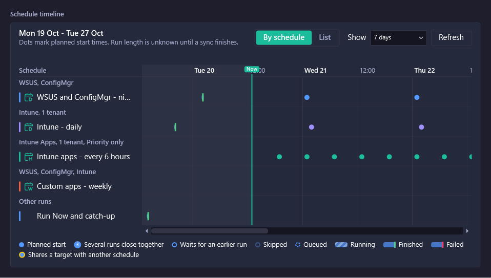
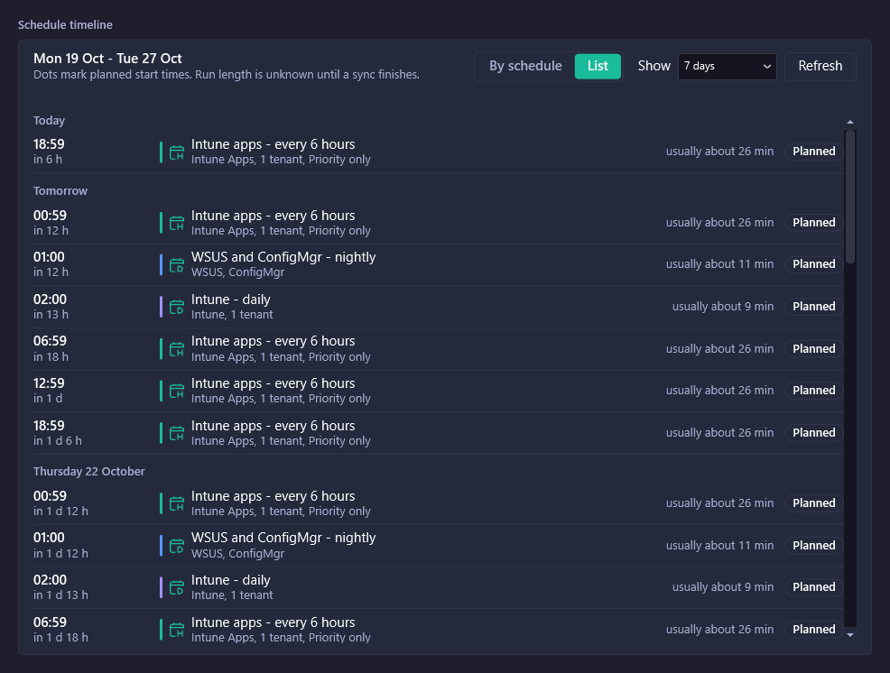

# Timeline

Use the **Timeline** page in Patch My PC Publisher (Publisher) to see when your schedules run. The timeline helps you spot overlapping schedules before they cause a run to wait or be skipped.

To open the page, go to **Sync** > **Timeline**.

<figure><figcaption></figcaption></figure>


Dots mark planned start times. Run length is unknown until a sync finishes, so the timeline uses the typical run length from previous syncs.


### Change the view

| Control     | Options                                                                 | Description                                                                                                                            |
| ----------- | ----------------------------------------------------------------------- | -------------------------------------------------------------------------------------------------------------------------------------- |
| View        | **By schedule**, **List**                                               | **By schedule** shows one lane for each schedule, grouped by target. **List** shows running and queued runs, then planned runs by day. |
| **Show**    | **4 hours**, **12 hours**, **1 day**, **3 days**, **7 days**, **Month** | Sets how far ahead the timeline shows. **Month** shows about 31 days.                                                                  |
| **Refresh** | Not applicable                                                          | Reloads the timeline from the Publishing Service.                                                                                      |

### By schedule view

The **By schedule** view groups lanes by target, such as Intune Updates, Intune Apps, ConfigMgr, and WSUS. Schedules that publish to more than one target appear in a mixed group. Manual runs and catch-up runs appear under **Other runs**. A line marks the current time.

Hover over a run to see:

* When the run starts.
* The target.
* How long the run typically takes.
* When the schedule last ran.

### List view

The **List** view shows each run with its start time, the time until it starts, the schedule name, and its targets. It also shows how long the run usually takes and its status, such as **Planned**. A warning appears when the run shares a target with another schedule.

<figure><figcaption></figcaption></figure>

### Legend

| Marker                                | Meaning                                                                                |
| ------------------------------------- | -------------------------------------------------------------------------------------- |
| Planned start                         | A run is scheduled to start.                                                           |
| Several runs close together           | More than one run is planned in a short period. Zoom in with **Show** to see each run. |
| Waits for an earlier run              | The run waits for an overlapping run to finish.                                        |
| Skipped                               | The run is skipped because it overlaps with another run.                               |
| Queued                                | The run is waiting to start.                                                           |
| Running                               | The run is in progress.                                                                |
| Finished                              | The run completed.                                                                     |
| Failed                                | The run completed with an error.                                                       |
| Shares a target with another schedule | The schedule publishes to the same target as another schedule at an overlapping time.  |

To change how a schedule handles overlaps, see Schedule.

### Related pages

* Schedule
* History
